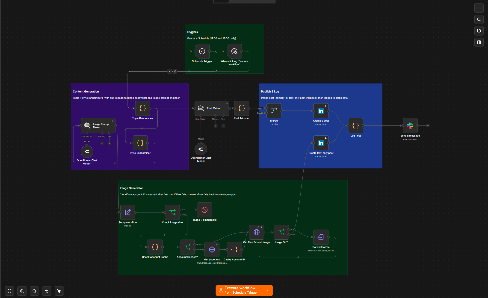

<div align="center">

# LinkedIn n8n Post Automation Workflow

**Free, no-code LinkedIn auto-poster — scale your network on autopilot.**

A fully scheduled n8n workflow that picks a fresh idea from your chosen topics, generates a polished LinkedIn post plus a matching AI image, and publishes the whole thing to your profile — twice a day, hands-free.

[](LICENSE)
[](https://n8n.io)
[](https://openrouter.ai)
[](https://developers.cloudflare.com/workers-ai/models/flux-1-schnell/)
[](https://learn.microsoft.com/en-us/linkedin/marketing/)
[]()
[](CONTRIBUTING.md)

[**Quick Start**](#-quick-start) · [**How it Works**](#-how-it-works) · [**Setup Guide**](docs/SETUP.md) · [**Docs**](docs/) · [**Contributing**](CONTRIBUTING.md)

---



---

</div>

## ✨ Why this workflow

Most LinkedIn auto-posters are either expensive SaaS subscriptions or flaky scripts that get your account restricted. This workflow is different:

| Pain point                                       | This workflow                                            |
| ------------------------------------------------ | -------------------------------------------------------- |
| Subscription tools ($30+/mo)                      | 100% free, runs on your own n8n                          |
| Same template-y posts → low reach                | New topic + new visual style every single run            |
| Repeats topics you already covered               | Anti-repeat memory of the last 7 topics                   |
| Markdown-mangled posts                           | Strips `**`/\* automatically before publishing          |
| Image generation costs                            | Uses Cloudflare Workers AI free tier (Flux.1 Schnell)    |
| Image generation failure → broken post           | Falls back to text-only post automatically               |
| Silent failures                                   | Slack notification + persistent post log in static data |
| Forced to schedule everything manually           | Cron-driven (08:00 & 18:00 UTC by default) + Manual run  |

---

## 🚀 Features

- 🧠 **Smart topic picker** — 40 hand-curated networking / CCNA / cybersecurity topics with rolling anti-repeat memory
- 🎨 **Image-style randomizer** — 8 distinct visual styles (3D Render, Cyberpunk, Flat, Isometric, Realistic, Line Art, Glassmorphism, Synthwave) with anti-repeat
- ✍️ **Long-form post writer** — DeepSeek v4-flash via OpenRouter; under 150 words, hook + emoji + bullet points + 3 hashtags + closing CTA question
- 🖼 **FLUX image engine** — Cloudflare Workers AI FLUX.1 Schnell, 1024×1024 default, 6 inference steps, random seed every run
- 🛡 **Hardened pipeline** — size validation guard (≤ 1MP), quality gate (≥ 50 chars), markdown stripper, hashtag cap (max 3), trim at 2900 chars
- 🔁 **Resilient by design** — image failure → text-only fallback; HTTP 3x retry with 5s backoff for upstream calls; `continueOnFail` for posting
- 📊 **Persistent log** — last 50 runs stored in n8n static data, accessible anytime
- 📣 **Slack notifications** — every run posts to a channel of your choice with topic + status + error
- ⏰ **Cron-driven + manual** — runs unattended and lets you fire it on demand for testing

---

## ⚡ Quick Start

> Prerequisites: a self-hosted or n8n.cloud instance (≥ 1.0), Node.js 18+ inside the n8n container, and credentials for the four services below.

1. **Clone this repo**

   ```bash
   git clone https://github.com/<your-username>/Linkdin_n8n_Post_automation_Workflow.git
   cd Linkdin_n8n_Post_automation_Workflow
   ```

2. **Import the workflow** into n8n
   - Open n8n → **Workflows** → ⋯ → **Import from File…**
   - Select `workflow.json` (the sanitized version) or `workflow.jason` (your original)
   - See [docs/SETUP.md](docs/SETUP.md) for the exact credentials to wire up

3. **Configure four credentials in n8n**
   - 🔑 **LinkedIn OAuth2** — needs `w_member_social` + `r_liteprofile` scopes
   - 🔑 **OpenRouter API** — for both `deepseek/deepseek-v4-flash` (post) and `deepseek/deepseek-chat` (image prompt)
   - 🔑 **Cloudflare Bearer (HTTP Bearer Auth)** — for `api.cloudflare.com`
   - 🔑 **Slack API** — for post-run notifications

   Full step-by-step in **[docs/SETUP.md](docs/SETUP.md)**.

4. **Replace credential placeholders** if you imported `workflow.json`. Open each credential-bearing node and re-pick your credential from the dropdown. n8n will rewrite the internal IDs automatically.

5. **Hit _Execute Workflow_ once** to confirm the run.

6. **Activate** the workflow to let the schedule take over.

That's it — your LinkedIn is now on autopilot.

---

## 🧭 How it Works

```
┌─────────────────────────────┐
│  Triggers                    │  Manual click + Schedule (08:00 & 18:00)
└──────────────┬───────────────┘
               ▼
┌─────────────────────────────┐
│  Content Generation          │  Topic Randomiser (40 topics, anti-repeat)
│                              │  Style Randomiser (8 styles, anti-repeat)
│                              │  Post Maker       → DeepSeek chat
│                              │  Image Prompt Maker → DeepSeek chat
└──────────────┬───────────────┘
               ▼
┌─────────────────────────────┐
│  Image Generation            │  Size validation → Cloudflare account cache
│                              │  Flux.1 Schnell HTTP → Image OK? →
│                              │  Convert to binary
└──────────────┬───────────────┘
               ▼
┌─────────────────────────────┐
│  Publish & Log               │  Merge → LinkedIn (image post) | fall back
│                              │  to text-only post → Log Post → Slack
└─────────────────────────────┘
```

For the full node-by-node breakdown — including every connection, every Code node's logic, and the failure paths — see **[docs/ARCHITECTURE.md](docs/ARCHITECTURE.md)**.

---

## 📂 Repository Layout

```
Linkdin_n8n_Post_automation_Workflow/
├── README.md                          ← You are here
├── LICENSE                            ← MIT
├── CHANGELOG.md                       ← Project changelog
├── CONTRIBUTING.md                    ← Contribution guide
├── CODE_OF_CONDUCT.md                 ← Community standards
├── CREDITS.md                         ← Attributions
├── SECURITY.md                        ← Security policy
├── workflow.json                      ← Sanitized n8n template (safe to commit)
├── workflow.jason                     ← Original file (kept for backward-compat)
├── docs/
│   ├── ARCHITECTURE.md                ← Node-by-node deep dive
│   ├── SETUP.md                       ← External service credentials
│   ├── CUSTOMIZATION.md               ← Topics, styles, prompts
│   ├── TROUBLESHOOTING.md             ← Common errors & fixes
│   └── SECURITY.md                    ← Credential hygiene
├── examples/
│   └── README.md                      ← Example outputs (text + image)
├── assets/
│   ├── architecture/
│   │   └── workflow-diagram.png
│   └── outputs/
│       └── README.md                  ← Showcase real runs here
├── scripts/
│   └── README.md                      ← Helper scripts
└── .github/
    ├── workflows/
    │   └── lint-markdown.yml
    └── ISSUE_TEMPLATE/
        ├── bug_report.md
        └── feature_request.md
```

---

## 🛠 Customization

Everything is configurable. The most common tweaks:

- **Add your own topics** → edit the `Topic Randomiser` node's `topics` array (see [docs/CUSTOMIZATION.md](docs/CUSTOMIZATION.md#topics))
- **Change posting cadence** → edit the `Schedule Trigger` node's `triggerAtHour` rules
- **Swap the LLM** → change the model name in either `OpenRouter Chat Model` node
- **Use a different image model** → swap the URL in `Get Flux Schnell image`
- **Adjust post tone/length** → edit the system & user prompt in `Post Maker`
- **Disable Slack notifications** → delete the final `Send a message` node

Full guide: **[docs/CUSTOMIZATION.md](docs/CUSTOMIZATION.md)**

---

## 🩺 Troubleshooting

The most common issues:

| Symptom                                  | Fix                                                                         |
| ---------------------------------------- | --------------------------------------------------------------------------- |
| `LinkedIn 401 Unauthorized`              | Reauthorize the OAuth2 credential in n8n — token may have expired          |
| `Image > 1 megapixel` stops the run      | Lower `width`/`height` in `Setup workflow` (1024×1024 = 1.04 MP → 1024×960) |
| `No post node executed` in Slack         | Image generation failed AND LinkedIn posted failed — check both credentials |
| Posts use bold/italic anyway              | DeepSeek ignored instructions — try `deepseek/deepseek-v3` or add a sample post to custom instructions |
| Topics repeat                             | Static data didn't persist — confirm `global` scope is enabled              |

More in **[docs/TROUBLESHOOTING.md](docs/TROUBLESHOOTING.md)**.

---

## 🔐 Security

The committed `workflow.json` is **sanitized** — credential IDs are placeholders. The original `workflow.jason` may contain real credential IDs; **do not publish it**. See [docs/SECURITY.md](docs/SECURITY.md) and [SECURITY.md](SECURITY.md).

If you fork and commit your own workflow:

- Re-run a credential scrub before pushing
- Use environment variables for any new credentials
- Treat the n8n instance like any OAuth-protected API surface

---

## 📜 License

Distributed under the **MIT License**. See [`LICENSE`](LICENSE) for the full text.

---

## 🙏 Credits

- Inspired by the no-code / low-code builder community
- Powered by [n8n](https://n8n.io), [OpenRouter](https://openrouter.ai), [Cloudflare Workers AI](https://developers.cloudflare.com/workers-ai/), [LinkedIn API](https://learn.microsoft.com/en-us/linkedin/marketing/), and [Slack](https://api.slack.com/)
- See [CREDITS.md](CREDITS.md) for attributions

---

<div align="center">

**If this saved you time, drop a ⭐ on the repo — it helps more people find it.**

Made with ❤ for the LinkedIn builder community.

</div>
